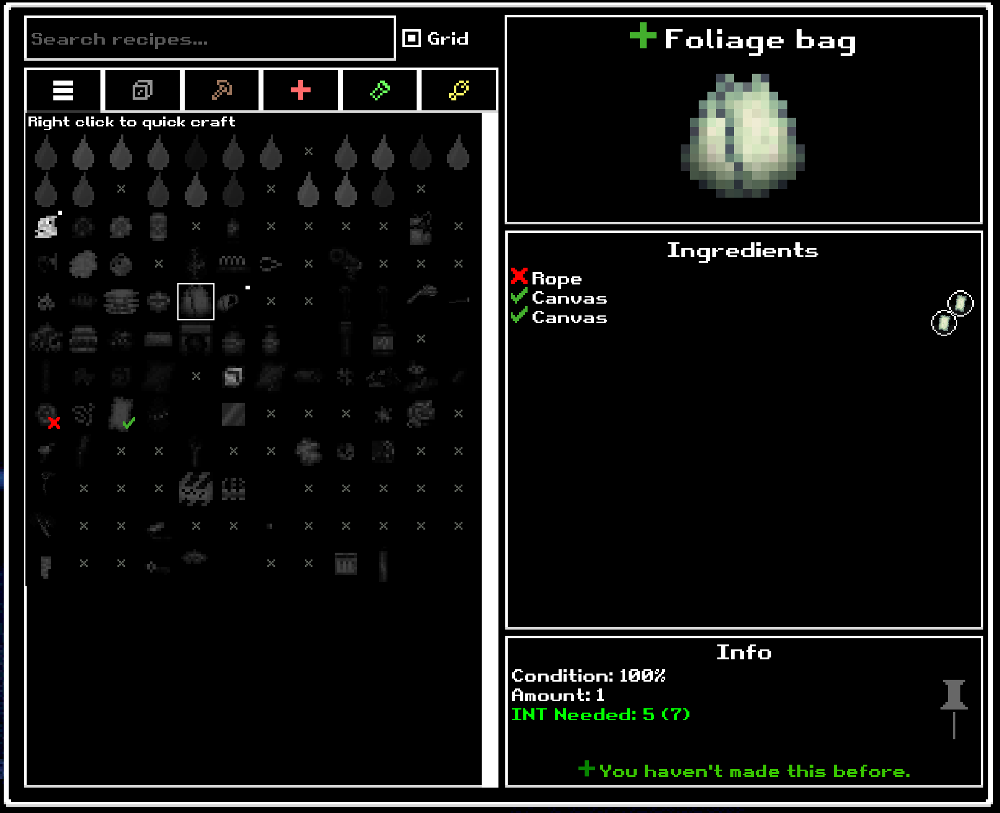

# Crafting Grid for Casualties: Unknown

A compact icon grid inside the game's original crafting menu. Keep the native search, filters, recipe details, tooltips, and crafting behavior, with a hand-picked layout that makes recipes easier to find.

Downloads: [GitHub Releases](https://github.com/uber5001/casualties-unknown-crafting-grid/releases/latest) · [Nexus Mods](https://www.nexusmods.com/scavprototype/mods/895)

## Install

Requires **Casualties: Unknown full release on Windows** and **BepInEx 5, Windows x64 / Mono**. Tested with game 1.0, Unity 2022.3.62f3, and BepInEx 5.4.23.5. The demo and multiplayer are untested.

1. If you already use BepInEx mods, keep your existing BepInEx 5 installation. Otherwise install the Windows x64 build from the [official BepInEx 5 releases](https://github.com/BepInEx/BepInEx/releases/tag/v5.4.23.5) into the folder containing `CasualtiesUnknown.exe`.
2. Close the game. Download `CraftingGrid-0.4.0.zip` from [Releases](https://github.com/uber5001/casualties-unknown-crafting-grid/releases/latest), open it, and copy its **BepInEx** folder into the game folder. Merge folders and replace the old Crafting Grid DLL when updating.
3. Start the game, load a run, and press **C**. The **Grid** checkbox beside search switches between the grid and original list.

The installed file should be `BepInEx/plugins/CraftingGrid/CasualtiesUnknown.CraftingGrid.dll`. No installer, extra library mods, or manual configuration edits are needed. Since 0.4.0 the plugin handles its startup persistence automatically and preserves existing BepInEx settings.

## Controls and indicators

- **Left click:** select a recipe and show its native details on the right.
- **Right click:** attempt to craft once. This also works on the large native recipe icon, even with Grid unchecked.
- **Hover:** native item tooltip and a top-left INT requirement using the game's colors.
- **Green check / red X:** recipes that supply ingredients for the selected recipe, showing whether those ingredient requirements are met.
- **Small white dot, top right:** recipes that use the selected recipe's output, including matching tool and liquid requirements. Unknown recipes are not revealed.
- **White outline:** selected recipe. Arrow keys and Submit retain native Unity Button navigation.
- **Category buttons:** tint matching recipes using the native filter icon's hue. Search hides unmatched recipes in place.

Craftable recipes show their normal icons. Unavailable icons are very dim grayscale; unknown recipes use dark anonymous crosses. Neighboring tiles meet edge to edge so the tooltip does not drop out between cells.

The authored arrangement uses 12 columns and 12 rows for the base catalog. Narrower views wrap groups and recipes in order. Other mods' recipes and future additions are read from the live registry and appended after the authored groups. The grid does not change recipes, crafting costs, outcomes, or progression.

## Update or uninstall

To update, close the game and replace the plugin DLL using the new ZIP. Your Grid checkbox preference is kept.

To uninstall, close the game and delete `BepInEx/plugins/CraftingGrid/`. Other mods and loader configuration are untouched. Optional preferences are in `BepInEx/config/uber5001.casualtiesunknown.craftinggrid.cfg`.

## Troubleshooting and compatibility

If no Grid checkbox appears, confirm you installed the DLL in the full game's folder and are using BepInEx 5 x64 / Mono. Check `BepInEx/LogOutput.log` for `Crafting Grid`. On a native API/UI error, the plugin restores the original interface and logs the exception.

Other mods registered through the native recipe system are picked up dynamically. Mods that replace the same crafting UI may conflict. Renamed outputs or changed variant ingredients may no longer match the authored layout; those recipes remain accessible at the end. The supplied layout is embedded in the DLL, so changing its source JSON requires rebuilding.

## Build from source

Requires an installed .NET SDK (tested with 9.0.306), local .NET Framework 4.7.2 reference assemblies, the retail managed game, and a local BepInEx 5 installation. Package feeds are disabled; nothing is downloaded by the build.

1. Copy `GamePaths.props.example` to `GamePaths.props` and set your game and loader paths.
2. Run `dotnet build src/CraftingGrid/CraftingGrid.csproj -c Release`.
3. Run `dotnet run --project tests/LayoutChecks/LayoutChecks.csproj -c Release` for layout checks.
4. Run `./scripts/Package.ps1` to create the same drag-and-drop release ZIP and checksum file.

The optional developer installer is `./scripts/Install.ps1 -GamePath 'C:\path\to\Casualties Unknown'`. Its `-LoaderSource` option can reuse an existing local BepInEx 5 installation; it never downloads software. API and historical development findings are in [integration notes](docs/integration-notes.md).

## License

[MIT](LICENSE), copyright 2026 uber5001. Game art and fonts are loaded from the installed game and are not included in the mod download. See [NOTICE](NOTICE) for third-party reference material.
